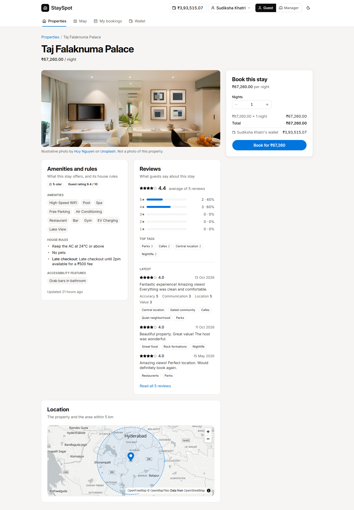
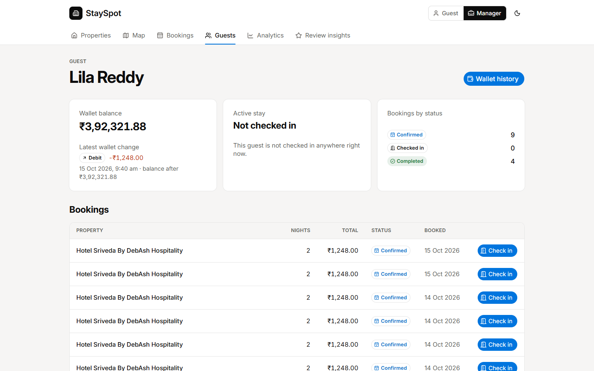
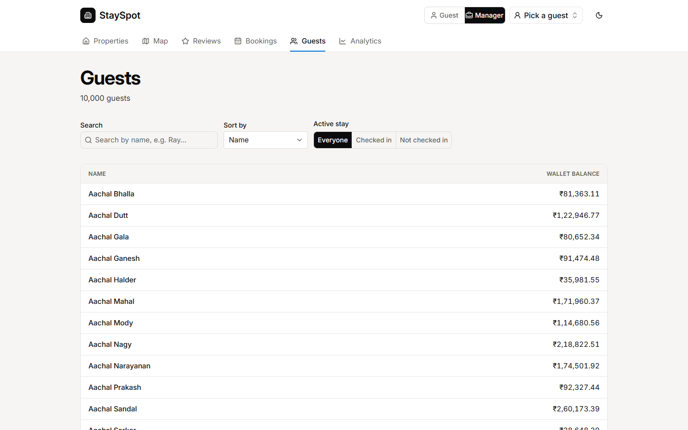
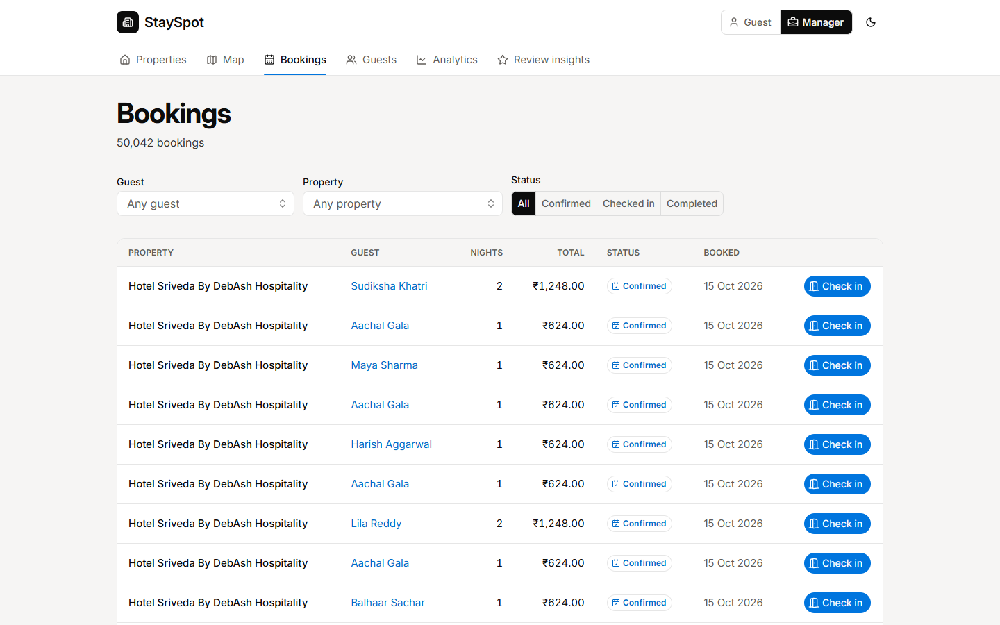
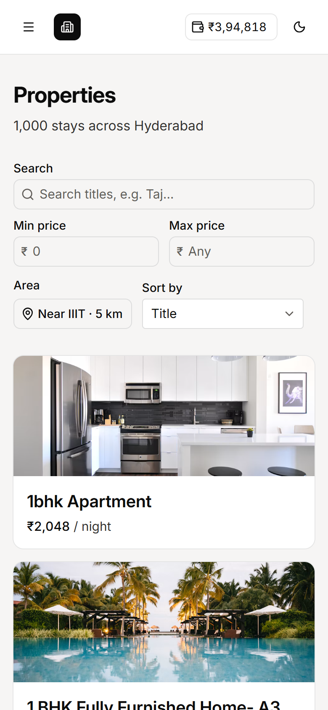
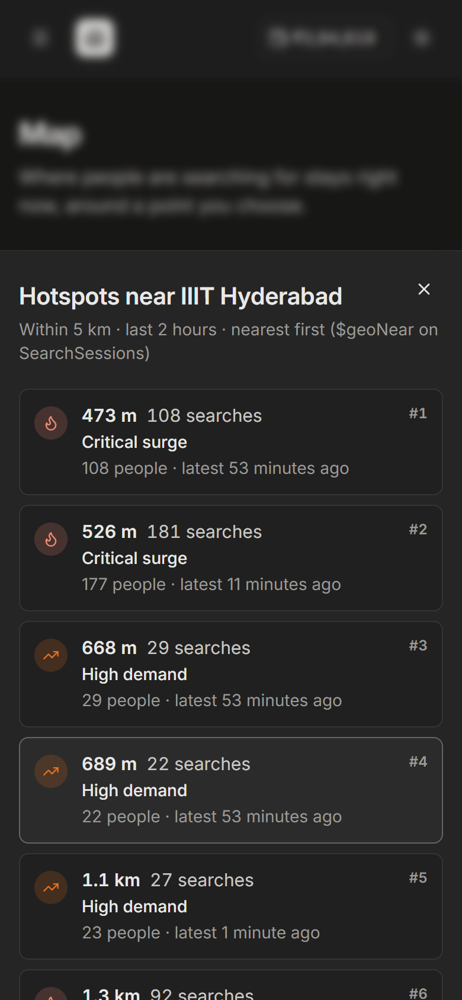
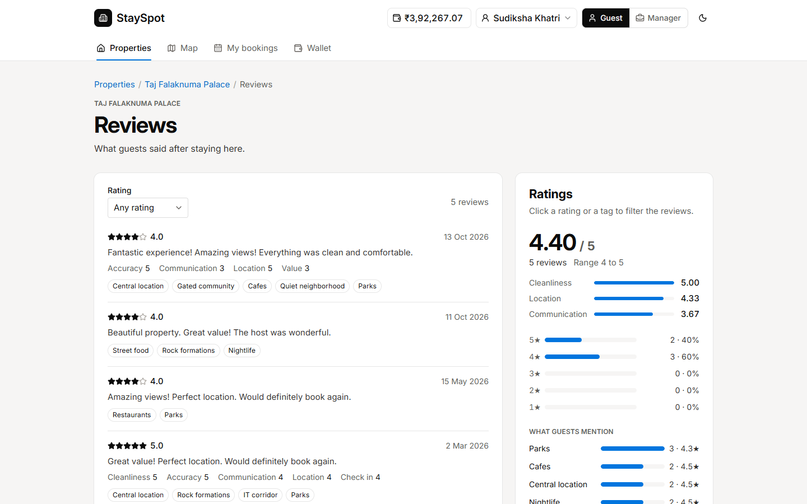

# StaySpot

Vacation rental database (PostgreSQL + MongoDB) from Assignment 1, with a server layer and a web front end for Assignment 2.
A guest can browse stays in Hyderabad, book one, top up their wallet and read reviews. An operations manager can move bookings through their statuses, look up guests, watch revenue and see how guests rate stays across the site. Both can see where people are searching on a live, full-screen map. Guests hover a property on it for a photo, name and price. Managers also get the list of search hotspots.

- Assignment 1 repository: https://github.com/rashhmi1/stayspot-database-a1
- Assignment 2 repository: https://github.com/mglsj/ssd-a2-g5
- Final commit: `TODO: fill in the hash of the submitted commit`
- Demo video: `TODO: add the link to the 5 minute demo`

## Contributions

| Member | Roll number | Contribution |
|---|---|---|
| Lakshyajeet Singh Jalal | 2026201063 | Frontend |
| TODO | TODO | TODO |
| TODO | TODO | TODO |
| TODO | TODO | TODO |

## Repository layout

```
README.md
docs/               handover_note.md, api_endpoints.md, design/ (screens, wireframes, screenshots, UI plan),
                    relational_erd.png, mongo_schema_map.json, README_a1.md
sql/                Assignment 1 schema, indexes, triggers, procedures, views, Workflow 2
mongo/              Assignment 1 collections and indexes, Workflows 3 and 4
data_generation/    Seeders (uv project)
performance/        EXPLAIN ANALYZE and explain("executionStats") output
scripts/            setup_db.sh, regenerate_performance.sh, screenshots.sh
api/                Server layer (Bun, Hono)
web/                Front end (SvelteKit)
```

The original Assignment 1 README is [`docs/README_a1.md`](docs/README_a1.md). Every change we made to the inherited scripts, and why, is in [`docs/handover_note.md`](docs/handover_note.md).

## Run it

You need Docker with VS Code (or any dev container client) and [Bun](https://bun.sh) 1.3 on the host.

### 1. Databases

Open the repo in the dev container (VS Code: "Reopen in Container"). It starts PostgreSQL 18 and MongoDB 8 and sets `PG_URI` and `MONGO_URI`.
Then build and seed both databases. This takes about 40 seconds and deletes existing StaySpot data.

```bash
bash scripts/setup_db.sh
```

Seeded search pins expire after 2 hours. To keep adding new ones for the map, leave this running:

```bash
uv run --project data_generation python data_generation/mongo_seeder.py --sessions 0 --live
```

### 2. API

Start the API inside the dev container. It listens on port 3000, which the container publishes to the host. Its interactive docs are at http://localhost:3000/api/docs. See [`api/README.md`](api/README.md).

```bash
cd api && bun install && bun run dev
```

### 3. Web, in development

Run the front end on the host, not in the container. `web/node_modules` holds platform binaries for the machine that installed them.

```bash
cd web && bun install && bun run dev
```

Open http://localhost:5173. The web server forwards every `/api/*` request to `API_URL` (default `http://localhost:3000`), so the browser only talks to one origin.

### 4. Web, in production

With the API running on port 3000, build the web app and start its Bun server on port 4173. The built server defaults to port 3000, which would clash with the API. It also assumes https unless a header says otherwise, so set `PROTOCOL_HEADER` when you run it over plain http.

```bash
cd web && bun run build
```

```bash
cd web && API_URL=http://localhost:3000 PORT=4173 PROTOCOL_HEADER=x-forwarded-proto bun ./build
```

Open http://localhost:4173. [`web/.env.example`](web/.env.example) lists these variables.

### Demo path

1. In the header, pick **Guest**. Open a property and press **Log in to continue**, then choose **Lowest balance**.
2. Book the stay. The booking fails with "Not enough in the wallet" and the balance stays the same.
3. Use **Top up** for the difference, then book again. The result shows the balance before and after and the new audit row.
4. Open **Wallet** to see the audit trail with opening and closing balances.
5. Switch to **Manager**. On **Guests**, filter to guests who are checked in, open one, and press **Check in** on one of their CONFIRMED bookings. The partial unique index blocks it, and the message links to the active stay.
6. On **Bookings**, complete a CHECKED_IN stay. Then on **Analytics**, press **Update figures** to see the materialized view change.
7. On **Map**, watch new pins arrive on the heatmap. As a guest, drop a pin, and hover a property marker to preview it. As a manager, hover a hotspot in the panel over the map to find it.
8. On **Review insights**, click a tag to filter the list. The count matches the tag's frequency. As a guest, the same filtering works on a property's own reviews page.

## Tests

```bash
cd api && bun run typecheck && bun test        # in the container; adds a few rows
cd web && bun run check                        # Svelte and TypeScript checks
cd web && bun run test:e2e                     # Playwright, against the dev server and the seeded databases
```

The Playwright tests in `web/tests/` cover the four flows we care most about:

- a booking the wallet cannot cover fails and leaves the balance and the bookings unchanged;
- a top-up, then a booking, then both rows in the audit trail;
- a second check-in blocked by `idx_active_stay`, with a link to the active stay;
- a pin dropped on the map that shows up at once and is stored in MongoDB.

`web/tests/roles.spec.ts` also checks what each role can see: a visitor logs in from the booking panel and is asked to log in for bookings and the wallet, a manager sees a property's performance instead of a booking panel and reads wallets without topping them up, and a guest cannot open manager pages.

They use Microsoft Edge, which ships with Windows, so no browser download is needed. Set `PW_CHANNEL=chromium` (after `bunx playwright install chromium`) to use Playwright's own browser, and `WEB_URL=http://localhost:4173` to test the production build. Each run books a stay and tops up a wallet.

## Screens

A switch in the header picks **Guest** or **Manager**, as the brief allows for demos. A guest starts logged out and logs in by choosing one of the seeded guest accounts; there are no passwords. A manager is never tied to a guest. Every list is paged, and every screen has loading, empty and error states and works at phone width and in dark mode. `/design` shows the design system.

| Screen | Route | Guest, logged out | Guest, logged in | Manager |
|---|---|---|---|---|
| Properties: search, price range, near IIIT, sort | `/properties` | Yes | Yes | Yes, plus a revenue sort |
| Property: amenities, reviews, map | `/properties/[id]` | "Log in to continue" in place of booking | Booking panel (Workflow 1) | Performance card: stays, nights, revenue |
| My bookings / all bookings | `/bookings` | Asked to log in | Own bookings | All bookings, with Check in and Complete |
| Booking detail and status timeline | `/bookings/[id]` | Asked to log in | Own bookings only | Any booking, with the next status action |
| Wallet and audit trail | `/guests/[id]/wallet` | Asked to log in | Own wallet, with top-up | Any wallet, read-only |
| Guests and guest detail | `/guests`, `/guests/[id]` | No | No | Yes |
| Analytics (Workflow 2) | `/analytics` | No | No | Yes |
| Map: search heatmap, property previews | `/map` | Yes, can drop a pin | Yes, can drop a pin | Yes, no pin dropping |
| Search hotspots and distance breakdown, over the map (Workflow 3) | `/map` | No | No | Yes |
| Property reviews: ratings, tags, paged list | `/properties/[id]/reviews` | Yes | Yes | Yes |
| Review insights across all properties, with the amenities document (Workflow 4) | `/reviews` | No | No | Yes |

The screen plan and wireframes are in [`docs/design/screens.md`](docs/design/screens.md). `bash scripts/screenshots.sh` rewrites these screenshots from the running app.

| | |
|---|---|
|  Properties |  Property detail |
|  Booking confirmed |  Not enough in the wallet |
|  Wallet and audit trail |  Guest detail |
|  Guests |  Bookings |
|  Second check-in blocked |  Map with the hotspot panel (manager) |
|  Review insights filtered by tag |  Analytics |
|  Phone width |  Map hotspots on a phone, dark mode |
|  A property's reviews | |

## Tech choices

| Part | Choice | Why |
|---|---|---|
| Front end | SvelteKit 3 with Svelte 5 | Little code per screen, file-based routes, and runes keep state simple. |
| Rendering | Client-side (`ssr = false`) | There is no auth and every page reads live data. TanStack Query, MapLibre and the charts all run in the browser, so server rendering would add hydration work for no gain. |
| Web server | `@sveltejs/adapter-bun` | The web app is its own Bun server next to the API. It serves the app shell and assets and runs the `/api` proxy. |
| Talking to the API | A `handle` hook that forwards `/api/*` to `API_URL` | One mechanism in dev and production. The browser only talks to the web origin, so CORS never matters. |
| API calls | The typed `hc` client from `api/src/client.ts` | Types come straight from the API's Zod schemas, so a wrong query value or field is a type error in `web/`. |
| Server state | TanStack Query (`@tanstack/svelte-query`) | Caching, loading and error states, retries and polling for the live map, with little code. |
| Styling | Tailwind CSS v4 and shadcn-svelte | Accessible components we own, themed from the tokens in `DESIGN.md`, with light and dark modes. |
| Map | MapLibre GL with `svelte-maplibre-gl`, OpenFreeMap basemaps | The API returns GeoJSON shaped for MapLibre sources. OpenFreeMap needs no API key. |
| Charts | Hand-written SVG for the moving average, plain bars elsewhere | Full control over direct end labels and a table view of the same data. Series colours come from the `--chart-*` tokens, which passed a contrast and colour-blindness check in both modes. |
| URL state | Filters, sort, page and tabs in the query string | Back and forward work, links can be shared, and a reload keeps the view. |
| Server layer | Bun, Hono and `@hono/zod-openapi` | Small and fast. One Zod schema per route validates input and generates the OpenAPI docs. |
| Databases | `Bun.sql` for PostgreSQL, the official `mongodb` driver | No ORM. The procedures, triggers, views and pipelines from Assignment 1 do the work, and the API runs the same Mongo pipeline builders as the scripts. |
| Tests | `bun test` for the API, Playwright for the browser flows | The API tests check each error code against the real databases. The browser tests walk the flows a user sees. |

## Assumptions

- **No real accounts.** Logging in means choosing a seeded guest, with no password, and the API trusts the `guest_id` it receives. The role switch stands in for staff sign-in. Hiding pages by role is a front-end convenience, not security.
- **Prices and money.** Every amount is in Indian rupees with two decimals. A stay costs `base_price * nights`. A booking has a number of nights but no calendar dates, so there is no availability check and two guests can book the same property at once.
- **Payment.** The wallet is the only way to pay. A top-up adds any positive amount with at most two decimals, with no payment gateway behind it.
- **Booking statuses.** A booking moves only forward: CONFIRMED, then CHECKED_IN, then COMPLETED. There is no cancellation or refund. A guest can have only one CHECKED_IN booking at a time, which the partial unique index enforces.
- **Who does what.** Guests book, top up and see their own bookings and wallet. Managers see all guests, bookings and wallets, move bookings through their statuses (check-in happens at the front desk) and see revenue. Managers do not book or top up. Everyone can browse properties, a property's reviews and the map. Site-wide review insights are for managers.
- **Revenue.** Analytics counts COMPLETED bookings only. The materialized view changes only when someone presses **Update figures**, and the page shows when that last happened.
- **Dates.** The moving average and the audit date filter use UTC days. Timestamps show in the viewer's time zone.
- **Map.** Search pins expire 2 hours after they are created (the TTL index), so the map needs the live seeder or dropped pins during a demo. The search area is a fixed 5 km circle, centred on IIIT Hyderabad unless the user picks another point.
- **Reviews.** Reviews come from the seed data and are read-only in the UI. A tag's frequency is the number of reviews that carry it.
- **Photos.** Property photos are illustrative stock photos from Unsplash, credited on the page, not photos of the real listings.
- **Browsers.** Current desktop and mobile browsers, from 375 px wide.

## Workflows from the command line

The UI runs these for you, but they still work on their own:

```sql
-- 1. Book a stay, then move it through its statuses
CALL sp_execute_booking('<guest_id>', '<property_id>', 3, NULL, NULL, NULL, NULL, NULL);
CALL sp_update_booking_status('<booking_id>', 'CHECKED_IN', NULL);
CALL sp_top_up_wallet('<guest_id>', 500, NULL, NULL, NULL);

-- 2. 7-day moving average and ranking
SELECT * FROM fn_property_moving_avg(CURRENT_DATE - 90, CURRENT_DATE, '<property_id>');
SELECT * FROM fn_property_revenue_rank(CURRENT_DATE, 10);
SELECT refresh_mv_property_summary();
```

```bash
mongosh "$MONGO_URI" mongo/02_workflow3_geonear.js   # 3. search hotspots within 5 km of IIIT Hyderabad
mongosh "$MONGO_URI" mongo/03_workflow4_facet.js     # 4. review analytics
```

Workflow 3 searches around another point when `HOTSPOT_LNG` and `HOTSPOT_LAT` are set.

## Performance proof

This rewrites `performance/postgres_explain_analyzes.txt` and `performance/mongo_execution_stats.json` from the seeded databases:

```bash
bash scripts/regenerate_performance.sh
```

