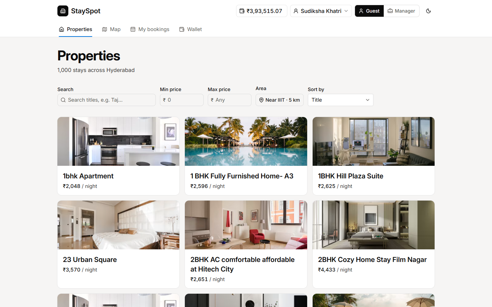
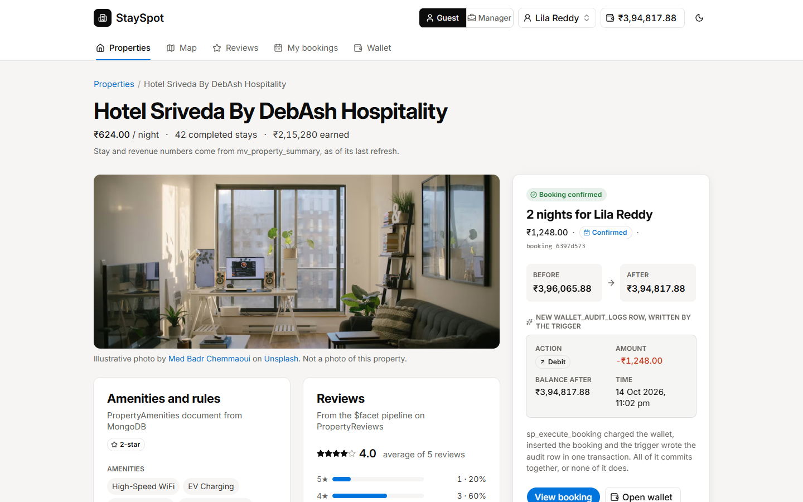
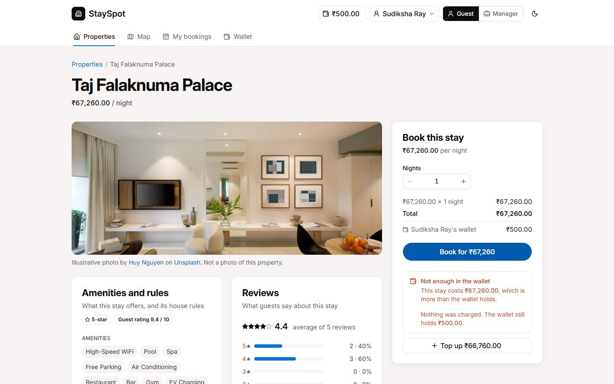
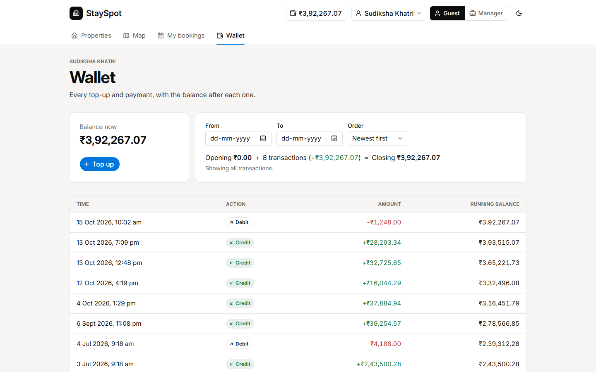
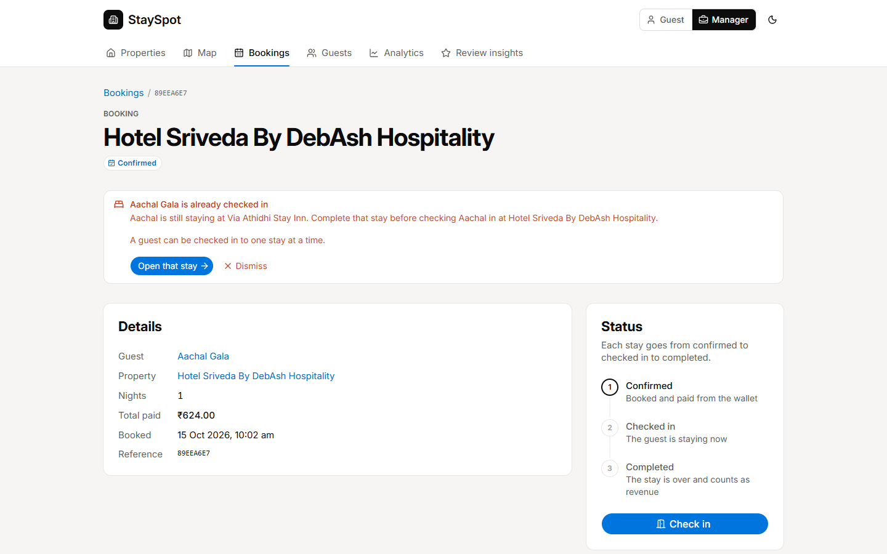
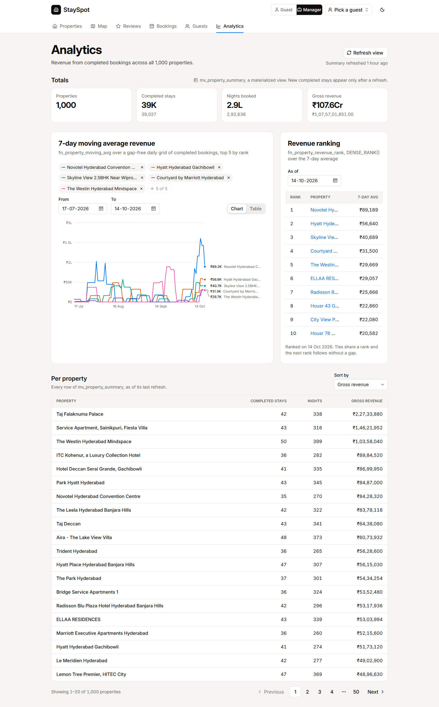
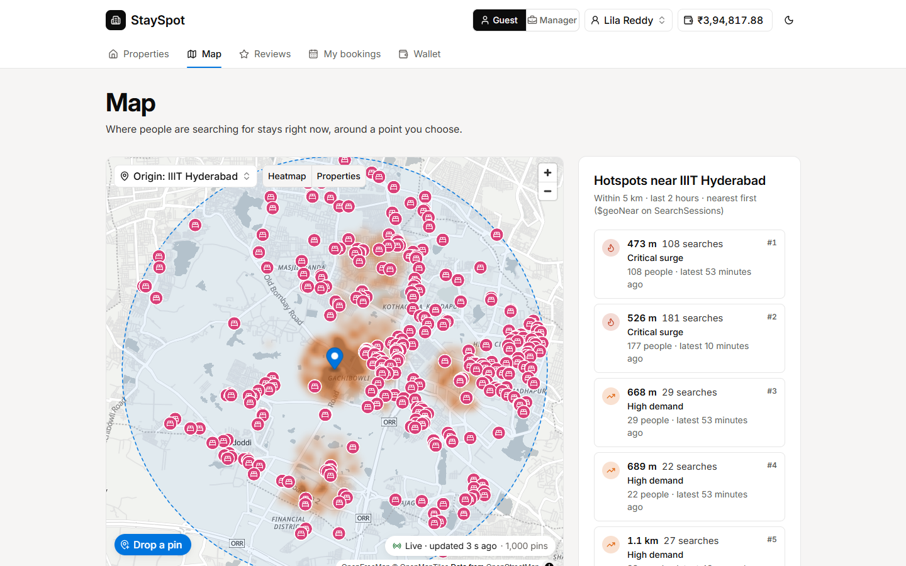
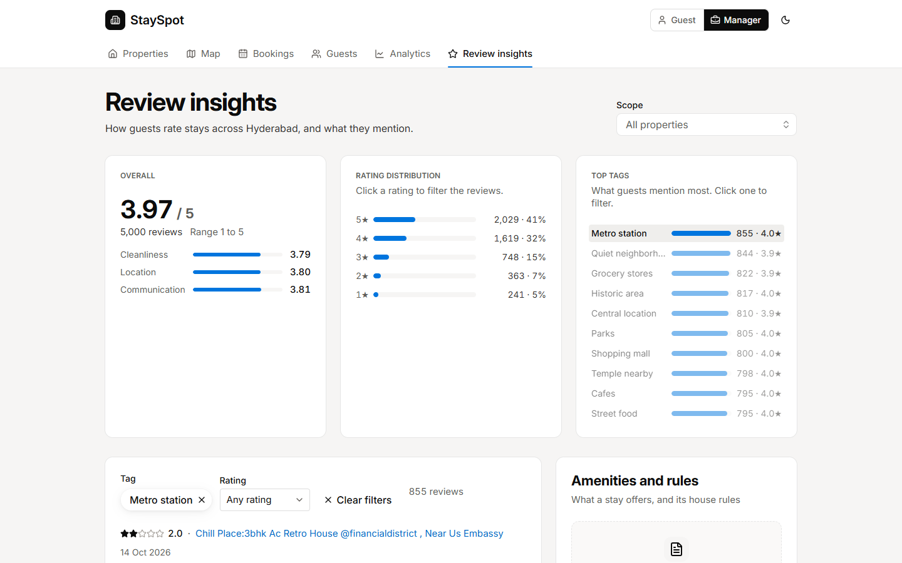

# StaySpot

StaySpot is a vacation rental system for Hyderabad. This repository extends the Assignment 1 database (PostgreSQL and MongoDB) with a server layer in `api/` and a web front end in `web/`. Guests browse and book stays, top up a wallet and review stays. Managers move bookings through their statuses and watch revenue, search hotspots and review insights.

- Assignment 1 repository: https://github.com/rashhmi1/stayspot-database-a1
- Assignment 2 repository: https://github.com/mglsj/ssd-a2-g5
- Final commit: `TODO: fill in the hash of the submitted commit`
- Demo video: `TODO: add the link to the 5 minute demo`

## Contributions

| Member | Roll number | Contribution |
|---|---|---|
| Lakshyajeet Singh Jalal | 2026201063 | Frontend |
| Subham Sarma | 2026202006 | Backend |
| TODO | TODO | TODO |
| TODO | TODO | TODO |

## Run it

You need Docker with a dev container client such as VS Code, and [Bun](https://bun.sh) 1.3 on the host.

1. Open the repository in the dev container. It starts PostgreSQL 18 and MongoDB 8 and sets `PG_URI` and `MONGO_URI`.
2. In the container, build and seed both databases. This takes about 40 seconds and deletes existing StaySpot data.

   ```bash
   bash scripts/setup_db.sh
   ```

3. In the container, start the API on port 3000. Its docs are at http://localhost:3000/api/docs.

   ```bash
   cd api && bun install && bun run dev
   ```

4. On the host, start the web app and open http://localhost:5173. It forwards `/api/*` to `API_URL` (default `http://localhost:3000`).

   ```bash
   cd web && bun install && bun run dev
   ```

Seeded search pins expire after 2 hours. To keep new pins arriving on the map, run this in the container:

```bash
uv run --project data_generation python data_generation/mongo_seeder.py --sessions 0 --live
```

To build and run both servers in one step, use `bash scripts/build_and_run.sh`. Tests: `cd api && bun test` in the container, and `cd web && bun run test:e2e` on the host.

## Screenshots

| | |
|---|---|
|  Properties |  Booking confirmed |
|  Not enough in the wallet |  Wallet and audit trail |
|  Second check-in blocked |  Analytics |
|  Map with the hotspot panel |  Review insights |

## Tech choices

| Part | Choice | Why |
|---|---|---|
| Front end | SvelteKit with Svelte 5, Tailwind CSS and shadcn-svelte | Little code per screen, accessible components we own, and light and dark themes. |
| Server state | TanStack Query | Caching, loading and error states, and polling for the live map. |
| Map | MapLibre GL with OpenFreeMap | The API returns GeoJSON for MapLibre, and the basemap needs no API key. |
| Server layer | Bun, Hono and `@hono/zod-openapi` | One Zod schema per route validates input and generates the API docs. |
| Databases | `Bun.sql` and the official `mongodb` driver, no ORM | The Assignment 1 procedures, triggers, views and pipelines do the work, and the API reuses the same Mongo pipeline builders. |
| Tests | `bun test` and Playwright | The API tests check each error against the real databases. The browser tests cover the booking, audit, second check-in and map flows. |

## Assumptions

- **Accounts.** There are no passwords. A guest logs in by choosing a seeded guest, and a header switch selects the manager role. Hiding pages by role is not security.
- **Money.** Amounts are in Indian rupees. A stay costs `base_price * nights`, and the wallet is the only way to pay. There is no availability check, so two guests can book the same property for the same dates.
- **Bookings.** A guest picks a check-in date from today to 365 days ahead. A booking moves only forward from CONFIRMED to CHECKED_IN to COMPLETED, with no cancellation or refund. A guest can have one CHECKED_IN booking at a time.
- **Reviews.** A guest can review a property once per completed stay.
- **Analytics.** Revenue counts COMPLETED bookings by the day they were booked. The materialized view changes only when a manager presses **Update figures**.
- **Map.** Search pins expire after 2 hours. The search area is a 5 km circle around IIIT Hyderabad unless the user picks another point.

## Changes to the inherited code

We fixed bugs in the Assignment 1 scripts and added features. Each change and its reason is in [`docs/handover_note.md`](docs/handover_note.md). The main ones:

- Fixed the `CHECKED_IN` status mismatch, the seeder's duplicate active stays and the empty materialized view.
- `sp_execute_booking` now raises named errors, rejects negative costs and takes a check-in date. `bookings` gained `nights` and `check_in_date`.
- `wallet_audit_logs` is append-only, and seeded balances match the audit ledger.
- Added `sp_update_booking_status` and `sp_top_up_wallet`.
- Rewrote Workflow 2 as a gap-free 7-day moving average with covering indexes, and as a revenue ranking.
- Changed the `SearchSessions` index to a compound 2dsphere index. The Workflow 3 and 4 scripts now export pipeline builders.
- Replaced the seed data with real Hyderabad listings.

The original Assignment 1 README is [`docs/README_a1.md`](docs/README_a1.md). The API endpoints are in [`docs/api_endpoints.md`](docs/api_endpoints.md), and the wireframes are in [`docs/design/`](docs/design/).
