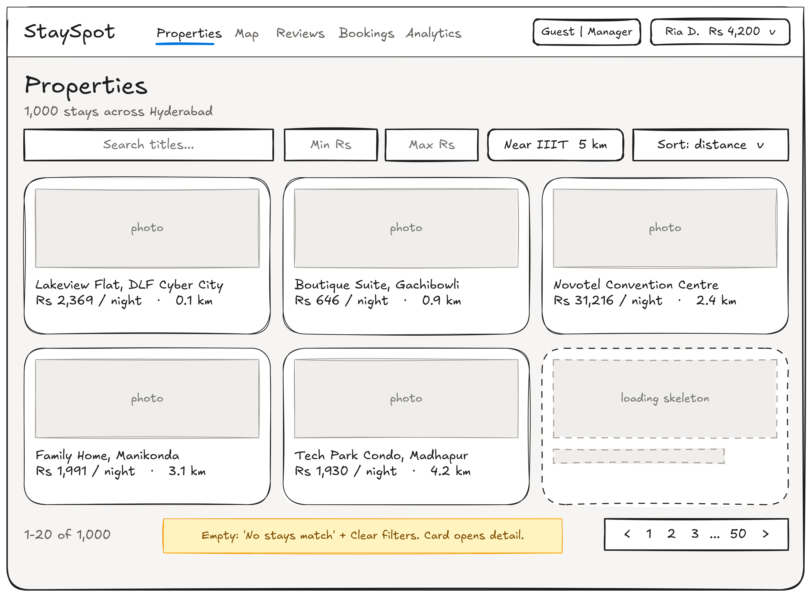
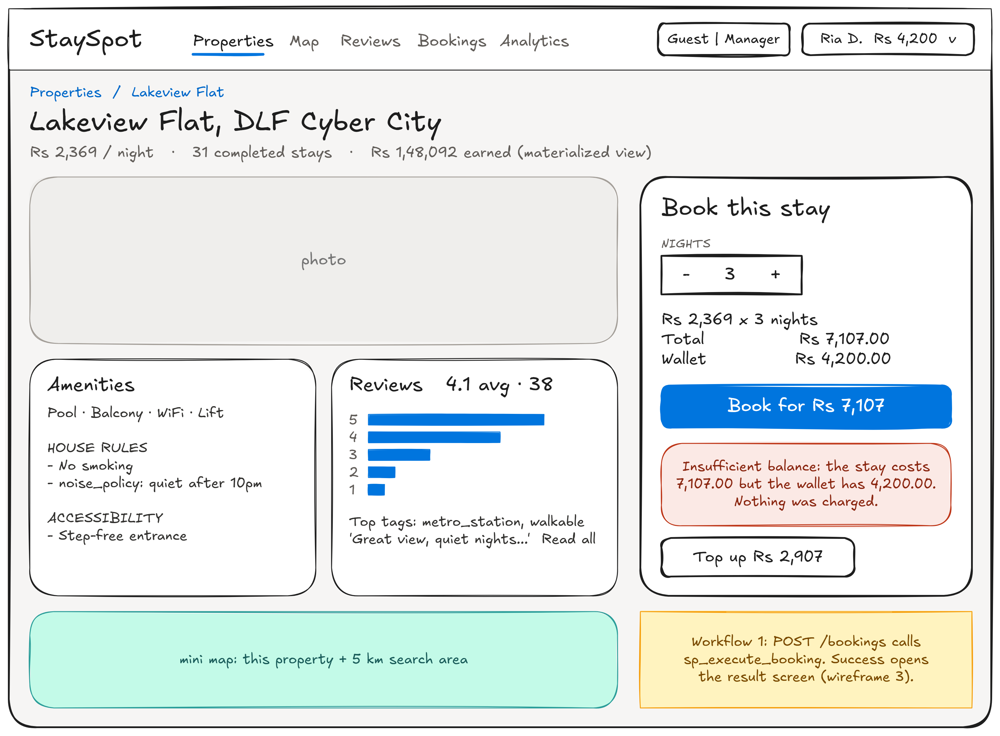
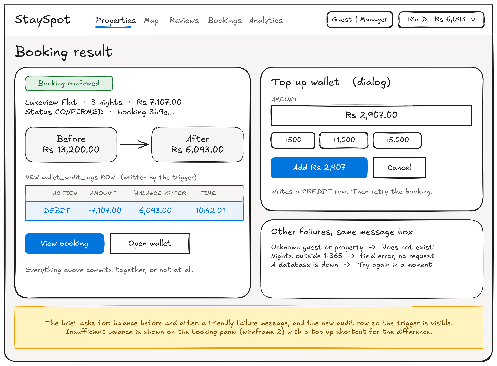
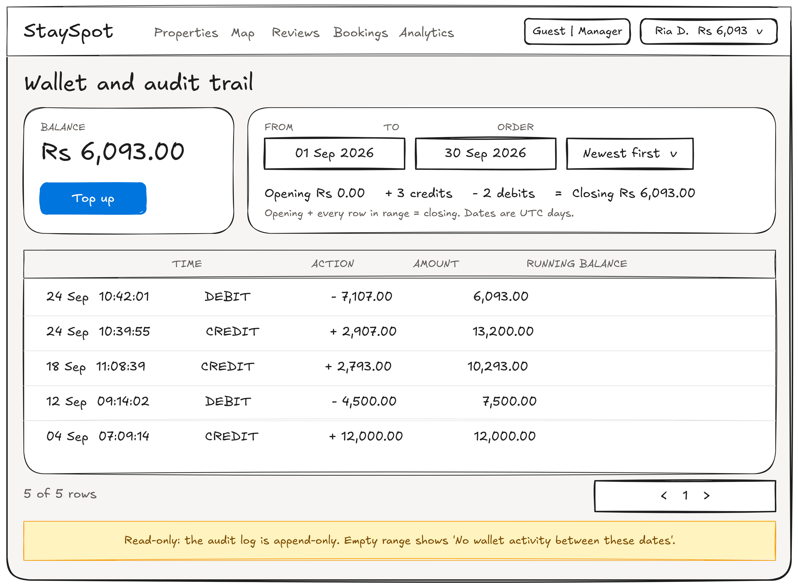
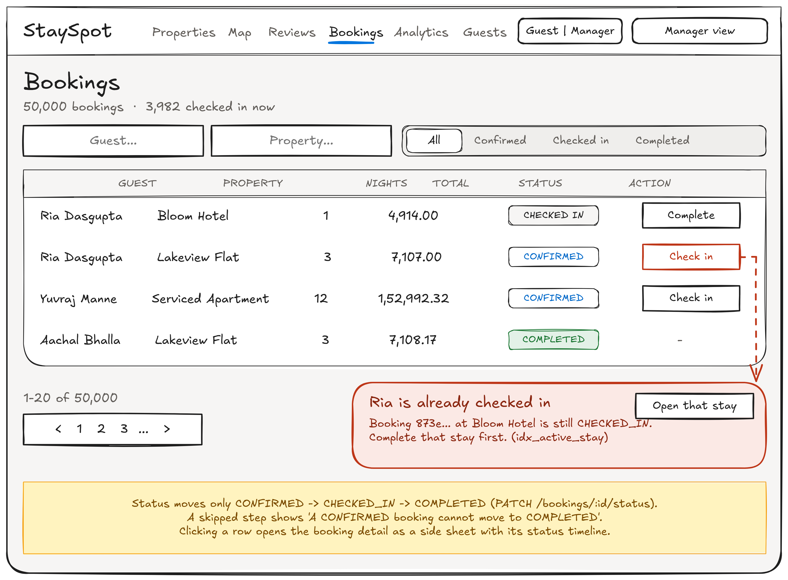
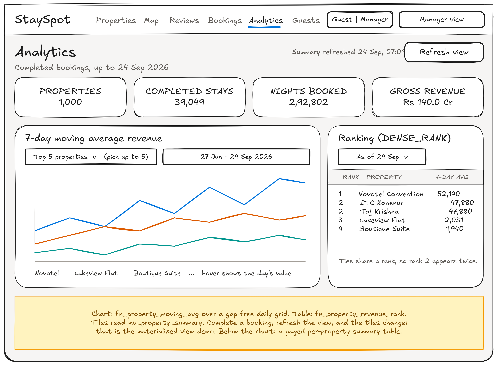
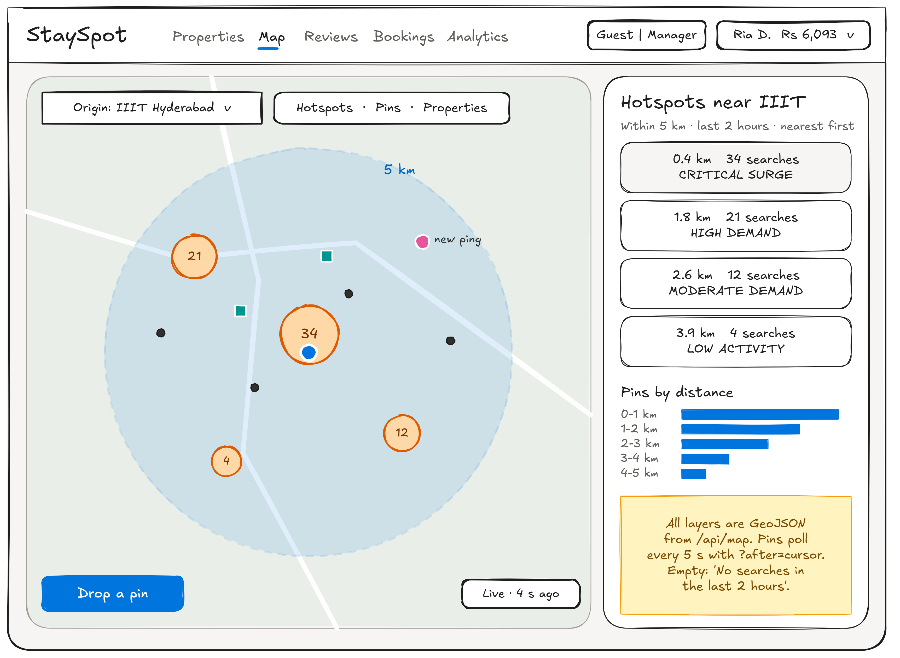
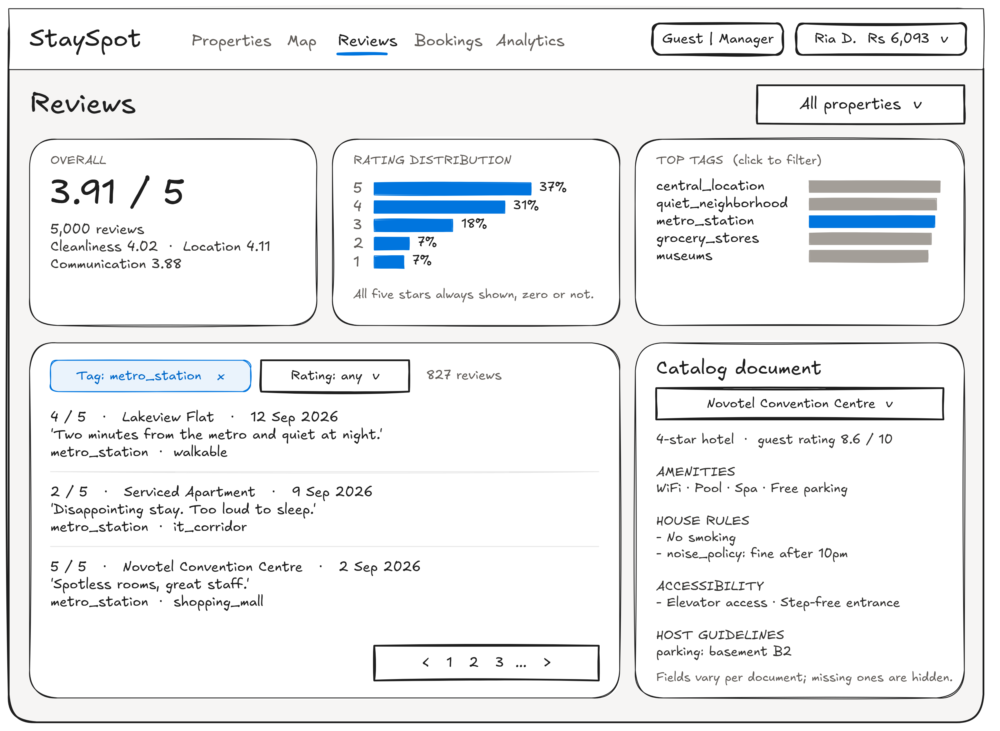

# Screens

This is the screen plan for the StaySpot front end in `web/`. Each screen maps to a requirement in the Assignment 2 brief and to the endpoints in [`docs/api_endpoints.md`](../api_endpoints.md).

## Users

- **Guest.** Browses stays in Hyderabad, books one, tops up their wallet and checks their spending. Reads reviews and looks at where people are searching on the map.
- **Operations manager.** Moves bookings through CONFIRMED, CHECKED_IN and COMPLETED, looks up guests, and watches revenue on the analytics screen.

There is no login. A switcher in the header picks the role and the active guest, as the brief allows for demos.

## Global pieces

| Piece | What it does | Endpoints |
|---|---|---|
| Header with role and guest switcher | Switch between guest and manager. Pick the active guest by name search. Shortcuts pick a low-balance guest (to show a failed booking) or a checked-in guest (to show the blocked second check-in). Shows the wallet balance. | `GET /guests?q`, `?sort=balance_asc`, `?has_active_stay=true`, `GET /guests/:id` |
| Error page and "database down" banner | Not-found and server errors, plus a banner when either database is down | `GET /health` |

## Screen list

| # | Screen | Route | Who | What it shows and does | Endpoints | Wireframe |
|---|---|---|---|---|---|---|
| 1 | Home | `/` | Both | Entry points per role. Guests see their balance and active stay; managers see headline numbers. | `GET /guests/:id`, `GET /analytics/summary?limit=1` | |
| 2 | Properties list | `/properties` | Guest | Search, price range, sort (price, revenue, distance), paged results | `GET /properties` | [1](wireframes/01-properties.png) |
| 3 | Property detail | `/properties/[id]` | Guest | Title, price, materialized-view summary, the amenities catalog document, the property's review facets and reviews, a mini map, and the booking panel | `GET /properties/:id`, `/:id/amenities`, `GET /reviews/analytics?property_id`, `GET /reviews?property_id`, `GET /map/area` | [2](wireframes/02-property-detail.png) |
| 4 | Book a stay (Workflow 1) | panel on screen 3, result at `/bookings/[id]` | Guest | Nights and live cost, then confirm. Success shows the balance before and after and the new audit row. Insufficient balance shows a friendly message and a "top up the difference" button. | `POST /bookings`, `POST /guests/:id/top-up` | [2](wireframes/02-property-detail.png), [3](wireframes/03-booking-result.png) |
| 5 | Wallet and audit trail | `/guests/[id]/wallet` | Both | Balance, top-up dialog, audit table with a date filter, opening and closing balance, running balance per row | `GET /guests/:id/audit`, `POST /guests/:id/top-up` | [4](wireframes/04-wallet-audit.png) |
| 6 | Guests list | `/guests` | Manager | Name search, sort by balance, active-stay filter, paged | `GET /guests` | uses the table pattern from 5 |
| 7 | Guest detail | `/guests/[id]` | Both | Profile, active stay, booking counts, latest audit row, the guest's bookings | `GET /guests/:id`, `GET /bookings?guest_id` | uses the card and table patterns |
| 8 | Bookings list | `/bookings` | Manager | Filter by guest, property and status. "Check in" and "Complete" on each row. Shows `ALREADY_CHECKED_IN` with a link to the active stay, and `INVALID_TRANSITION`. | `GET /bookings`, `PATCH /bookings/:id/status` | [5](wireframes/05-bookings.png) |
| 9 | Booking detail | side sheet on screen 8 | Both | One booking and its status timeline with the next allowed action | `GET /bookings/:id`, `PATCH /bookings/:id/status` | noted on 5 |
| 10 | Analytics (Workflow 2) | `/analytics` | Manager | 7-day moving average chart (top 5 by default, pick up to 5), the DENSE_RANK table with an as-of date, materialized-view totals with "last refreshed" and a refresh button | `GET /analytics/moving-average`, `/rank`, `/summary`, `POST /analytics/summary/refresh` | [6](wireframes/06-analytics.png) |
| 11 | Map (Workflow 3) | `/map` | Both | Choose an origin, draw the 5 km circle, show hotspot, pin and property layers. A hotspot list sorted by distance. New pins appear by polling. "Drop a pin" and a distance-ring chart. | `GET /map/hotspots`, `/pins?after`, `POST /map/pins`, `/map/properties`, `/map/area`, `/map/density` | [7](wireframes/07-map.png) |
| 12 | Reviews (Workflow 4) | `/reviews` | Both | Rating distribution, top tags (click to filter), overall average and sub-ratings, paged review list, and a property picker that shows its catalog document | `GET /reviews/analytics`, `GET /reviews?tag`, `GET /properties/:id/amenities` | [8](wireframes/08-reviews.png) |

`/design` shows the design system: every token and component from `DESIGN.md`. It is not a product screen.

To keep scope small, the booking flow lives on the property page (4 inside 3), and the booking detail is a side sheet on the bookings list (9 inside 8). Home can also redirect to properties for guests and analytics for managers.

## States every screen handles

- **Loading.** Skeleton placeholders in the shape of the content.
- **Empty.** A sentence and a next step, for example "No searches in the last 2 hours" on the map or "No wallet activity between these dates".
- **Error.** The API's `message`, chosen by its `code`. Screens 4 and 8 show the failures the brief asks for.
- **Phone width.** Tables turn into stacked cards, and the map's side list becomes a bottom sheet.

## Wireframes

Hand-drawn sketches in [`wireframes/`](wireframes/). Each one has a PNG and an `.excalidraw` source that opens at [excalidraw.com](https://excalidraw.com) for editing. The yellow notes explain behaviour that a static sketch cannot show.

### 1. Properties list

### 2. Property detail and booking panel

### 3. Booking result and top-up

### 4. Wallet and audit trail

### 5. Bookings (manager)

### 6. Analytics

### 7. Map

### 8. Reviews

